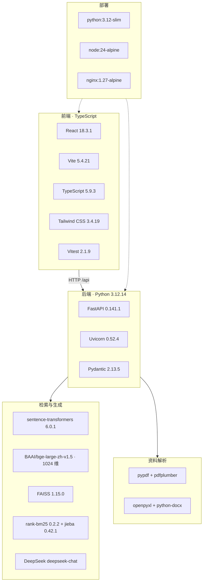
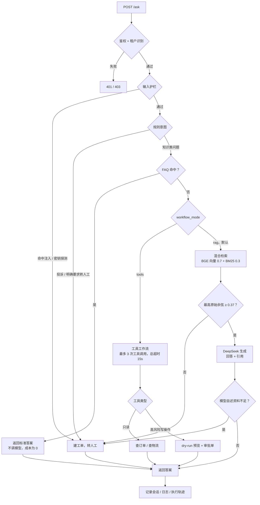
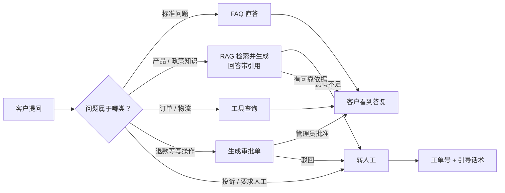

# 技术栈、版本与流程图

> 数据来源：2026-10-17 在本机实际读取 `backend/.venv` 的包元数据、`web/package.json` 与
> `npm ls --depth=0`、两个 Dockerfile 的 `FROM` 行，以及仓库内代码文件统计。
> 版本分两种口径：**声明版本**（requirements.txt / package.json）与**实际安装版本**（本机 venv / node_modules）。

---

## 1. 语言构成

| 语言 / 文件类型 | 用途 | 文件数 | 行数（约） |
| --- | --- | ---: | ---: |
| **Python** | 后端全部业务逻辑、检索、评测、脚本 | 76 | 7,990 |
| **TypeScript / TSX** | 前端页面、组件、API 抽象层 | 26 | 2,703 |
| JavaScript | 前端构建配置（Vite / Tailwind / PostCSS） | 3 | 100 |
| CSS | 全局样式与设计令牌 | 2 | 148 |
| HTML | 前端入口页 | 1 | 13 |
| PowerShell | 一键启动、语料导入、Docker 修复脚本 | 3 | 176 |
| Markdown | 文档与语料 | 50 | 7,829 |
| YAML / JSON / Dockerfile / Nginx conf | 部署编排、CI、数据文件 | — | — |

主要开发语言是 **Python（后端）+ TypeScript（前端）**；PowerShell 只用于 Windows 本地脚本。

---

## 2. 后端技术栈

运行时：**Python 3.12.14**（虚拟环境 `.venv`）；容器基础镜像 `python:3.12-slim`。

| 类别 | 组件 | 实际安装版本 | 作用 |
| --- | --- | --- | --- |
| Web 框架 | FastAPI | **0.141.1** | 20+ 接口、依赖注入、自动生成 OpenAPI 文档 |
| ASGI 服务器 | Uvicorn | **0.52.4** | 运行 FastAPI，支持流式响应 |
| 数据校验 | Pydantic | **2.13.5** | 请求/响应模型与工具入参校验 |
| 向量模型 | sentence-transformers | **6.0.1** | 加载 `BAAI/bge-large-zh-v1.5`（1024 维） |
| 推理运行时 | torch | **2.14.0** | 模型推理（CPU） |
| 模型库 | transformers | **5.17.0** | sentence-transformers 的底层依赖 |
| 向量检索 | faiss-cpu | **1.15.0** | 本地精确内积检索（IndexFlatIP + IDMap2） |
| 关键词检索 | rank-bm25 | **0.2.2** | BM25 打分 |
| 中文分词 | jieba | **0.42.1** | BM25 的中文切词 |
| HTTP 客户端 | httpx | **0.28.1** | 调用 DeepSeek、网页导入、评测 |
| PDF 解析 | pypdf | **6.18.1** | 文本层提取 |
| PDF 表格 | pdfplumber | **0.11.10** | 表格抽取后转 Markdown |
| Excel 解析 | openpyxl | **3.1.5** | `.xlsx` 逐 sheet 转 Markdown 表格 |
| Word 解析 | python-docx | **1.2.0** | `.docx` 段落与表格按序提取 |
| 文件上传 | python-multipart | **0.0.32** | multipart/form-data |
| 鉴权 | PyJWT | **2.14.0** | 可选 OIDC/JWT 校验 |
| 测试 | pytest | **8.4.2** | 167 个后端用例 |
| 静态检查 | ruff | **0.16.8** | 代码检查（CI 中执行） |
| 数值计算 | numpy | **2.5.3** | 向量运算 |

生成模型：**DeepSeek `deepseek-chat`**，通过 OpenAI 兼容的 HTTP 接口调用（没有引入官方 SDK）。

---

## 3. 前端技术栈

运行时：**Node.js v24.15.0 / npm 11.12.1**；容器构建镜像 `node:24-alpine`，运行镜像 `nginx:1.27-alpine`。

| 类别 | 组件 | 声明版本 | 实际安装版本 |
| --- | --- | --- | --- |
| UI 框架 | React | `^18.3.1` | **18.3.1** |
| DOM 渲染 | react-dom | `^18.3.1` | **18.3.1** |
| 构建工具 | Vite | `^5.4.11` | **5.4.21** |
| React 插件 | @vitejs/plugin-react | `^4.3.4` | **4.7.0** |
| 语言 | TypeScript | `^5.6.3` | **5.9.3** |
| 样式框架 | Tailwind CSS | `^3.4.15` | **3.4.19** |
| CSS 处理 | PostCSS / Autoprefixer | `^8.4.49` / `^10.4.20` | 8.5.28 / 10.5.6 |
| 测试框架 | Vitest | `^2.1.9` | **2.1.9** |
| 组件测试 | @testing-library/react | `^16.3.3` | **16.3.3** |
| DOM 环境 | jsdom | `^25.0.1` | **25.0.1** |

前端没有用 UI 组件库（没有 Ant Design / MUI / shadcn），组件与设计令牌都是项目内自己实现的。

---

## 4. 技术栈总览

---

## 5. 工作流（代码执行路径）

对应 `backend/app/main.py` 的 `/ask` 接口。虚线分叉表示判定条件。

---

## 6. 业务流（客户视角）

---

## 7. 版本管理现状（需要注意的风险）

| 项目 | 现状 | 风险 |
| --- | --- | --- |
| 前端 | `package.json` 用 `^` 版本范围，但 `package-lock.json` 锁定实际版本，`npm ci` 可复现 | 低 |
| 后端 | `requirements.txt` 只写了 `>=` 下限，**没有 lock 文件**；本机装的是上表这些版本，但换台机器重装可能装到更新的版本 | **中**：FastAPI / Pydantic / torch 的大版本变化可能带来不兼容 |
| 模型 | `BAAI/bge-large-zh-v1.5` 权重缓存在 `models/huggingface`，未锁定 revision | 低（模型更新不频繁） |
| 容器 | `python:3.12-slim`、`node:24-alpine`、`nginx:1.27-alpine` 未固定到 digest | 低到中 |

建议：如需长期维护，补一份 `backend/requirements.lock`（`pip freeze > requirements.lock`）并在 Dockerfile 中安装 lock 文件，把版本风险降到和前端同一水平。
